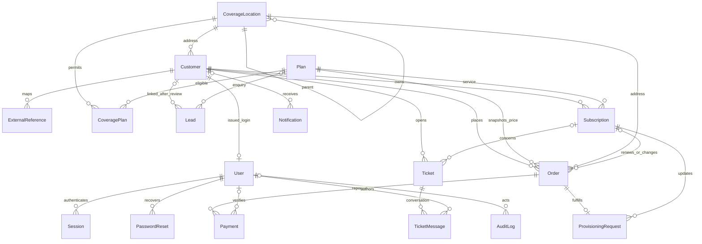
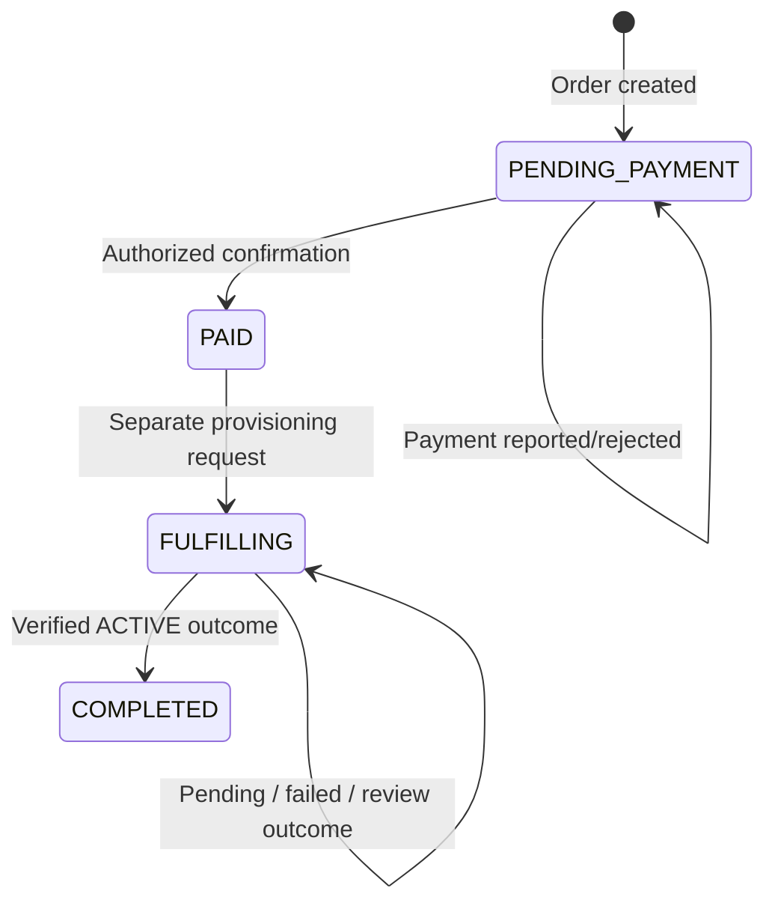

# Architecture record - 2026-10-19

## Authority and gaps

The supplied `Ikonectti_Visual_Architecture_Blueprint (2).pdf` defines the three applications,
shared services, staff-created accounts, coverage hierarchy, financial verification, separate
provisioning, lightweight assistance, RBAC and replaceable integrations. The pasted Agent 1 brief
defines the backend implementation task and confirmed TypeScript/NestJS/PostgreSQL/Prisma direction.
Existing repository architecture notes describe a frontend presentation rather than an existing API.
No backend, detailed approved ERD, API contract or agent-instruction file was found in the checkout.

The relational schema below is an implementation proposal consistent with those requirements,
not a claim that a missing detailed ERD was approved. Frontend catalogue/reference prices were
not promoted into verified production data. No existing frontend files were modified.

## Module boundaries

`AppModule` composes Identity, Admin, Customers, Leads, Plans, Coverage, Orders, Payments,
Subscriptions, Provisioning, Support, Notifications, Assistant, Reporting, Legacy, Integrations
and Audit modules. Domain services own validation and transaction transitions. Controllers validate
shared Zod request contracts and project explicit public/staff response contracts. Global guards
resolve the current database session and enforce role/action and customer ownership boundaries.

`core/` owns configuration, transactions, cryptography, error normalization and HTTP contracts.
`integrations/` defines provider-neutral interfaces, disabled/manual implementations and labeled
development simulators. Controllers never trust a role/customerId/payment status supplied by a
customer request. Prisma uses serializable mutation transactions with bounded conflict retries.

## Proposed ERD

17 database tables. Customer UUID remains stable when the unique account number is replaced.
Roles are fixed permission sets, stored on staff principals; staff identities are distinct from
customer identities. BigInt amounts are minor units with positive-value/currency checks, serialized
as safe JSON integers within contract bounds. Orders retain financial snapshots; plans are directly
editable. Payments retain verifier identity/time/reference/evidence. Audit records are append-only.

Country -> State -> City/LGA -> District/Area -> Street/Estate -> Building/Address is validated
on location creation. Parent links cannot be edited through API endpoints; no cycles are introduced.
Only building/address records carry final eligibility and plan links. UNKNOWN is explicit.

## State transitions

Payment state is independent: REPORTED -> CONFIRMED or REJECTED. Final review is immutable;
repeating the same decision is idempotent. Only one payment can confirm a pending order because
the payment/order mutation is serializable. A unique provisioning order reference plus serializable
transactions prevents duplicate subscription creation. An ACTIVE result cannot extend dates twice.
No financial initiation or customer report activates service. Confirmed manual outcomes require
PROVISIONER/ADMIN permission and evidence. Gateway selection and live provisioning remain external.

## Remaining discovery

- Client's detailed ERD and any additional business-account/delegation requirements.
- Official account-number format and verified mapping/import rules.
- Approved catalogue, billing intervals, eligibility dataset and coverage maintenance ownership.
- Payment provider, bank verification policy, gateway credentials/signature/idempotency specification.
- Legacy CRM/customer, live billing/usage and ISP provisioning APIs and authoritative status mappings.
- Approved SMS/email providers, sender identities, templates and recovery-channel policy.
- Hosting, domains/TLS/proxy topology, backup/restore and monitoring arrangements.
- Renewal/plan-change/proration/refund/cancellation and reconciliation policies beyond this baseline.

These gaps do not prevent core API integration against labeled fixtures and manual workflows.
They do prevent claiming connected production services or live network/billing/usage status.
