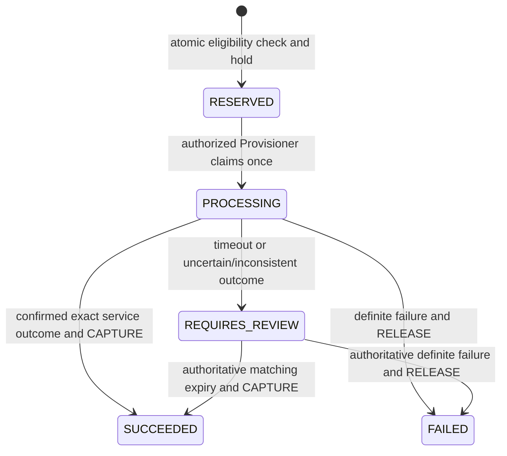

# Stage 5A internal wallet and renewal accounting

API1.2.0 includes the superseding settlement clarification. This is internal, non-transferable customer account credit. There is no withdrawal, bank account, cash-out, inter-customer transfer, connected gateway or external wallet payment capability. See `contracts/SETTLEMENT_HANDOFF.md`.

## Persistence and allocation

One `Wallet` per `Customer` is opened automatically by a database trigger, including non-HTTP fixture paths. Existing customers are backfilled with **zero**, without converting any historical payments. `Payment` retains its required orderId and original meaning. Separate `WalletTopUp` records explicitly allocate manual reports to WALLET. A shared immutable `PaymentReference` registry normalizes references identically in PostgreSQL and prevents order/top-up reuse, including direct fixture inserts and native upserts. Rejection does not recycle a claimed reference.

`WalletEntry` is an immutable append-only financial history. Each row has actor, unique operation/reference, deltas, post-entry snapshots and optional top-up, renewal or compensating-original link. `WalletRenewal` stores immutable customer consent/economic terms and the linked WALLET-funded renewal `Order`. It doubles as the hold's lifecycle record; RESERVE/CAPTURE/RELEASE entries retain the complete hold history.

| Entry | Posted delta | Reserved delta | Result |
| --- | --- | --- | --- |
| TOPUP_CREDIT | +amount | 0 | Only a verified wallet-allocated top-up |
| SETTLEMENT_CREDIT | +amount | 0 | Validated approved-provider settlement, system actor, unique registered payment/event |
| ADJUSTMENT_CREDIT | +amount | 0 | Authorized correction with reason |
| RESERVE | 0 | +amount | Spendable funds become held |
| CAPTURE | −amount | −amount | Confirmed service outcome spends the hold |
| RELEASE | 0 | −amount | Definite failure restores available funds |
| REVERSAL | −original credit | 0 | Full compensating correction, while sufficient available funds remain |

All storage uses PostgreSQL BIGINT NGN minor units; API bounds are1000000000000minor. Available is posted−reserved. A BEFORE INSERT ledger trigger locks the wallet, maintains its projection and inserts authoritative post-entry snapshots. Constraints require0≤reserved≤posted≤limit. Direct projection edits/nonzero opening/owner reassignment are rejected. Ledger updates/deletes are forbidden. Deferred checks require top-up confirmation and credit, or renewal hold/final financial/service state, in the **same committed transaction**. Matching holds and exclusive capture/release are enforced. Terminal renewal outcomes and reserved economic terms cannot be rewritten.

Services use serializable transactions, wallet/subscription row locks, unique operation keys, unique per-customer idempotency keys and a partial unique pending-renewal index. PostgreSQL serialization/deadlock failures are retried for Prisma P2034 and raw lock-query P2010/40001/40P01, then yield an explicit conflict. Provider calls occur outside the DB transaction after one persisted PROCESSING claim. No network retry is performed merely because an HTTP request is repeated.

## Renewal contract

Wallet funding and service activation are independent. Zero/positive funds and active/inactive services are all valid combinations. A settled payment never creates an order/renewal/provisioning job or changes subscription state. No recurring renewal exists. The customer explicitly confirms the quote; only then can reservation and separate authorized service processing begin.

The service must explicitly have renewalEnabled=true (default false); its plan must have an explicitly approved renewalPriceMinor and known billingDays. Ownership, account/service state, known dates/permanent external service ID, publication/customer audience, verified building mapping, provider mode, conflict and available funds are checked. There is no invented early-renewal window. priceVersion binds confirmation to the current plan version; stale consent is rejected. Amounts and new periods are computed server-side from authoritative data, never client balances/prices.

Permanent Subscription.externalServiceId is preserved across renewals. Outcome references stay on WalletRenewal. A manual acknowledgement is PROCESSING, not success. SIMULATED CONFIRMED is explicitly a development result with its confirmed expiry. Success atomically updates the existing subscription and finalizes the debit; failure preserves the previous service period and releases funds. Historical order payments are not manufactured for wallet-funded orders, nor can those orders accept duplicate order payments.

Manual reconciliation requires Provisioner/ADMIN permission, an explicit authoritative attestation, reference, evidence and exact confirmedEndsAt for success. Finance may inspect but cannot attest service outcomes. If authoritative expiry differs from the reserved period, or another system changed the old expiry, funds remain held for review. **The current resolver intentionally cannot price or reconcile a different service period.** That needs an approved provider/commercial reconciliation policy; never falsely attest failure simply to release a known-success hold.

Credit corrections are Finance/ADMIN only. Full reversal is allowed for TOPUP_CREDIT/ADJUSTMENT_CREDIT and creates a compensating row. Held/spent credits cannot be reversed into an overdraft. CAPTURE/refund, partial refund, cancellation and chargeback policy are outside this scope. No arbitrary balance setter exists.

## Verification and deployment boundary

The superseding provider-settlement boundary adds `SettlementPayment` and immutable `SettlementEvent` to the five original wallet tables. The same WalletEntry ledger posts SETTLEMENT_CREDIT and maintains the customer projection. Only authenticated, independently retrieved SETTLED status may credit; the default adapter is disabled, with no public callback/checkout. Funding cannot write service/order/renewal/provisioning state. A repeatable-read reconciliation compares ledger sums and settlement allocation. The current backend suite passes73 tests: the original60 plus13 settlement/authenticity, replay/concurrency, state-independence, rollback/redelivery and proof-integrity scenarios. See `contracts/SETTLEMENT_HANDOFF.md` and `docs/stage5a/SETTLEMENT_ARCHITECTURE_CLARIFICATION.md` for the current contract, allocation policy and evidence; earlier60-test results below describe the original wallet delivery.

The backend suite adds21 wallet/accounting scenarios to39 existing tests:60pass/0fail in the isolated Stage5 test database on55438. They include concurrent confirmation/spending, repeat settlement, historical/fixture reference protection, native-upsert compatibility, stale pricing, exact amount2500000→1950000→550000, failure/timeout/manual acknowledgement, authoritative-period discrepancy, permanent service-ID preservation, correction/compensation, customer isolation/session expiry, roles and direct SQL corruption rejection.

The additive migration creates five new tables plus nullable renewal price, default-disabled service policy and default ORDER_PAYMENT funding. Back up the development database and verify unchanged historical payment fingerprints/zero opening wallet credits before new acceptance mutations. Do not apply to production as part of this task. Production still requires approved bank instructions, provider specifications, reconciliation/refund policies, operational ownership and deployment configuration. Existing request-ID logs omit request bodies, credentials and financial evidence.
