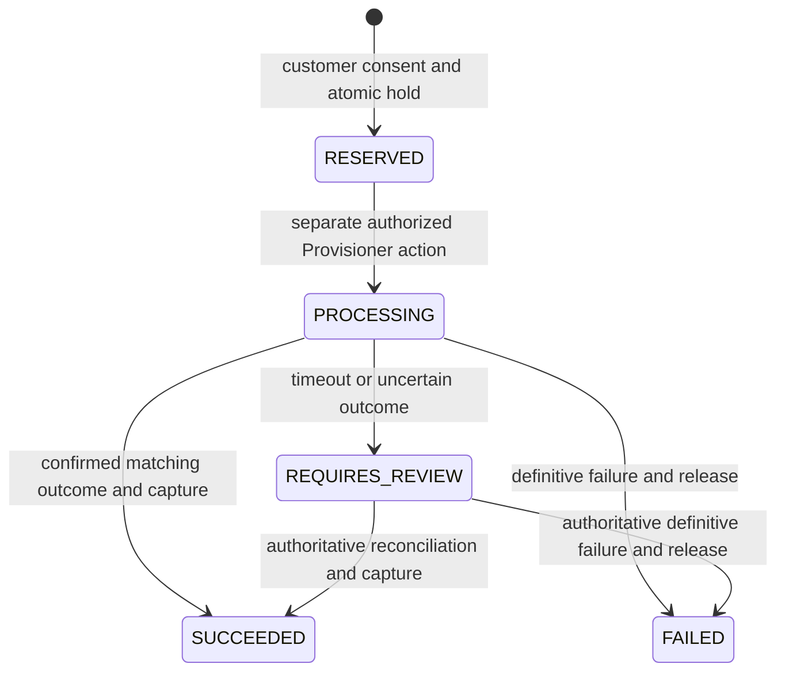

# IKONECTT — STAGE 5A WALLET & SELF-SERVICE INTEGRATION REPORT

21 October 2026 · Local development · API 1.1.0

## Delivery scope

Stage 5A adds an internal customer credit wallet, manually reported and Finance-verified top-ups, and wallet-funded renewal of explicitly eligible existing services. The backend, My Ikonectt and Admin/CRM share one canonical HTTP contract and database. This is a development integration; payment and provider acceptance records are explicitly SIMULATED. No real bank transfer or connected payment gateway is claimed.

Work starts from verified Stage 4 `aaaed6d5c032ef6715f7baba068d9e4c9ab5d7d7`, includes approved Admin `33e5463eb06e629806bb8c56783188633072c494` and portal `a8ea3fc899454ba26f361a13be214877cdca853f` refinements, and preserves the later approved portal SPA correction. Changes remain on `codex/ikonectt-wallet-stage5a`; there is no merge to main or production deployment.

## Folder boundaries

| Folder | Contents and owner |
| --- | --- |
| `backend/src/wallet/` | Agent 1: controllers, transactional financial service, explicit service-renewal adapter |
| `backend/prisma/` | Agent 1: schema, additive wallet migration and PostgreSQL integrity triggers |
| `backend/src/identity/`, `backend/src/core/` | Existing identity/permissions and serializable transaction helper; additive grants and retry handling |
| `backend/test/wallet.test.ts` | Financial, concurrency, security and direct-database integrity tests |
| `backend/scripts/wallet-acceptance.ts` | Guarded local API acceptance and isolated simulated browser-record preparation |
| `backend/scripts/wallet-persistence.ts` | Read-only fingerprints for restart/restore verification; no credential or evidence text output |
| `contracts/` | Agent 1: canonical schemas/client, OpenAPI, permission/endpoint map and `WALLET_HANDOFF.md` |
| `my-ikonectt/` | Agent 2: customer frontend, wallet/service views, HTTP adapter, independent dependencies/tests/build and pinned contract copies |
| `admin/` | Agent 3: staff frontend, wallet review/corrections/service operations, permissions, independent dependencies/tests/build and pinned contract copies |
| `scripts/platform*.mjs` | Development supervisor, installation, contract parity and built-asset preview tools |
| `docs/stage5a/` | This integration report and credential-free migration/API/persistence evidence |
| `.platform/` | Git-ignored configuration references, runtime logs/control token and private acceptance accounts |
| Website folders and root presentation assets | Existing public website; preserved on its separate approval track |

The customer frontend never imports backend services or Prisma. Admin also uses HTTP with server-side authorization. Each frontend owns its display/adaptation code; neither computes an authoritative balance, price, eligibility or service period. Canonical snapshots are pinned and checked against source, including Admin permissions.

## Accounting and payment allocation

There are five additive tables: `Wallet`, `WalletEntry`, `WalletTopUp`, `WalletRenewal` and `PaymentReference`. Every customer has one wallet, created automatically even through fixture insertion paths. Existing customers receive zero wallets, not converted payment credit. Existing `Payment.orderId` and order-payment verification retain their meaning; top-ups are separate and explicitly allocated to the wallet. WALLET-funded renewal orders cannot also receive an order payment.

All money is integer NGN minor units stored in PostgreSQL BIGINT. `postedMinor` represents unspent verified credits; `reservedMinor` represents holds; the backend supplies `availableMinor = postedMinor - reservedMinor`. Pending top-up reports are separately displayed and cannot be spent.

| Ledger entry | Posted change | Reserved change | Trigger |
| --- | --- | --- | --- |
| TOPUP_CREDIT | +amount | 0 | Finance confirms an explicitly wallet-allocated report |
| ADJUSTMENT_CREDIT | +amount | 0 | Authorized positive correction with reason |
| RESERVE | 0 | +amount | Customer consent and atomic service eligibility/funds check |
| CAPTURE | −amount | −amount | Authoritatively confirmed service-renewal outcome |
| RELEASE | 0 | −amount | Definitive service-renewal failure |
| REVERSAL | −original credit | 0 | Full compensating reversal with reason and sufficient available funds |

Ledger rows are append-only and retain actor, reference, signed deltas and authoritative post-entry snapshots. PostgreSQL locks the wallet and updates its projection with the entry. Direct projection edits, nonzero opening balances, ledger mutation/deletion and owner reassignment are rejected. Deferred constraints require a verified top-up and its one credit, or a legitimate renewal settlement and matching service outcome, to commit together. Reserved terms and terminal outcomes cannot be rewritten.

Top-up, renewal, adjustment and reversal intents use persistent UUID idempotency keys and payload fingerprints. Replays return the original result; a changed payload conflicts. Finance confirmation is exactly-once under concurrent requests. A global normalized immutable reference registry prevents reuse across historical order payments, top-ups and direct fixture paths. Rejected references are not silently recycled.

Serializable transactions, row locks, unique pending-renewal constraints and database balance bounds prevent concurrent overdraft. The transaction helper retries PostgreSQL serialization/deadlock errors reported through both Prisma transaction and raw-query error forms, then returns a conflict if retries are exhausted. Provider calls happen outside database transactions after one persisted processing claim.

## Renewal eligibility and lifecycle

Renewal requires ownership, active customer, explicitly enabled ACTIVE/SUSPENDED service, known start/end/permanent provider service ID, a published matching-audience plan with approved positive renewal price and known billing period, available building/plan mapping, compatible provider mode, no conflicting renewal and sufficient available funds. Default service policy is disabled and renewal price is nullable; ordinary ACTIVE services are not silently made renewable.

The quote returns authoritative amount, current/expected expiry and price version. Customer confirmation sends a UUID and that price version, never a trusted price or balance. Stale quotes require another review. Expected expiry uses the known existing expiry, or current server time for an expired service, plus the approved known billing period. No fixed early-renewal window or usage data is invented.

A reservation is not a debit or service success. A provider acknowledgement remains PROCESSING. Timeout or inconsistent outcome retains the hold for review. Repeated process requests never blindly resend an already processing/reviewable operation. Confirmed success atomically captures the hold, completes its WALLET-funded order and updates the existing subscription; the permanent external service ID is preserved. Definitive failure releases funds and preserves the old service period.

Manual reconciliation requires Provisioner/Admin permission, explicit authoritative attestation, provider reference and evidence. Success also requires the reserved expected expiry and unchanged previous subscription expiry. **Different confirmed service periods cannot currently be repriced or reconciled through this resolver.** Those cases stay held for review pending an approved provider/commercial policy. Never mark a known success as failed merely to release a hold.

## Contract and permissions

Canonical API **1.1.0**, `/api/v1`: **78 paths / 95 operations**, including 20 additive wallet/renewal operations. Consumer source pin: `cb05bb65c96c0b5bfff9c0a8a53b275d23659625`. Existing structured errors, pagination and revocable bearer sessions remain. Full route/request/response table: [`contracts/WALLET_HANDOFF.md`](../../contracts/WALLET_HANDOFF.md).

| Role | Wallet/history | Top-up evidence and verification | Positive correction/full credit reversal | Renewal inspection | Policy/process/authoritative resolution |
| --- | --- | --- | --- | --- | --- |
| Customer | Own only | Report own; own status without staff evidence | No | Own only; eligible request | No |
| SUPPORT | Read | No | No | Read | No |
| FINANCE | Read | Yes | Yes, reason required | Read | No |
| PROVISIONER | No financial credit grant | No | No | Read | Yes |
| ADMIN | Read | Yes | Yes | Read | Yes |
| SALES / EXECUTIVE | No wallet grants | No | No | No wallet renewal grants | No |

Backend guards enforce this matrix. Support read access does not expose top-up evidence or approval endpoints. Finance cannot attest provider outcomes. Provisioner cannot create credits. Unauthorized/expired sessions, cross-customer IDs, invalid inputs, changed idempotency payloads and stale consent are tested.

## Customer and staff interfaces

My Ikonectt adds a restrained dashboard wallet summary; Wallet page with available/reserved/pending values and transaction history; evidence/reference top-up reporting; contextual service renewal eligibility, quote confirmation and progress; and Top Up actions for insufficient funds. It retains approved white/light-gray/cream/red styling, branding and responsive navigation. The SPA correction retains the sidebar/header and refreshes route content and relevant live data while preserving session checks.

Admin/CRM adds customer wallet/history, Finance top-up review and verification, controlled positive corrections and compensating reversals with reasons, renewal inspection and separate authorized Provisioner processing/reconciliation. Existing approved sidebar groups and visual refinements are retained. Support receives read-only wallet information without financial controls.

Both frontends consume authoritative API responses. Explicit development fixtures remain separate; a failed live operation does not become mock success. No bank account instructions were supplied: the API exposes manual reporting with an approved-channel notice and `bankDetails:null`.

## Migration and historical protection

Before applying `202610210001_wallet` to the owned local development database, a custom-format backup was created and restored into a separate verification database. The active database/environment was not replaced. Migration SHA-256: `afcc85d83092618e07a3ee61db2e144f010a037f55ad090a6180c27dc46d12c5`.

Immediately after migration: 17 customers, 17 zero wallets, zero wallet entries/top-ups/renewals. All 20 pre-existing payment rows retained the same fingerprint: `60e73982e2873b0802f5ec9758a8d7ad83e7240d37c4fd0170c26bcef4b5ea32`. Evidence: [`migration-verification.json`](migration-verification.json). No historical payment was credited. Actor relation metadata in Prisma describes the already installed foreign keys; it does not require another SQL migration.

## Acceptance evidence

All scenarios use isolated SIMULATED development records. The API harness uses real HTTP and canonical response validation. Provider timeout is prepared through the same backend service with an in-process test-only timeout adapter; subsequent status and safe repeated-process checks use real HTTP. No public failure switch or active owner environment is changed. PostgreSQL-backed concurrency is tested in the automated backend suite, not by claiming two browser clicks are a concurrency test.

| Scenario | Result and method |
| --- | --- |
| A: ₦25,000 top-up | API: pending report unspendable, Finance confirmation/replay creates exactly one credit. Separate live customer/Finance browser journey verifies the same allocation. |
| B: ₦19,500 renewal | API: reservation/replay, separate Provisioner action, one confirmed capture and ₦5,500 available. Live browser journey independently checks held funds before staff processing. |
| C: insufficient funds | API rejects another ₦19,500 request at ₦5,500 without another hold/order/debit; customer UI offers Top Up. |
| D: timeout | REQUIRES_REVIEW retains ₦19,500 held; safe process replay does not resend. Customer/Admin read-only browser checks inspect the protected timeout fixture. |
| E: consistency and roles | Customer and Support HTTP summaries/history match exactly; Support credit attempt is403. Separate customer/Finance/Support browser readbacks verify display and controls. |
| F: historical allocation | Migration preserves all old payments with zero opening credits; a confirmed isolated order payment also leaves its wallet zero and its reference cannot fund a top-up. |
| G: concurrent spend | PostgreSQL integration tests submit competing intents against one wallet and against one service; no negative available funds or duplicate active renewal. Concurrent Finance confirmation is also exactly-once. |

API evidence: [`api-acceptance-d6ec3f94.json`](api-acceptance-d6ec3f94.json). Automated backend suite: **60 passed / 0 failed** (39 existing and 21 wallet tests), including direct SQL tamper rejection, failure/release, manual acknowledgement, authoritative mismatch, permanent service ID, compensation, ownership and session checks. Existing website regression suite: **143 passed / 0 failed**; website production build passed in an isolated export so tracked website output was not rewritten.

The joint browser journey completed with top-up `7bd78286-1694-4559-be69-71edcfd6e44d`, renewal `e63ad55e-d577-48b0-beb6-a2dfe168f26c` and subscription `7dddabe9-5e29-4aa1-bd6c-27dfbba1aecb`. Customer, Finance and Support independently observed the final ₦5,500 balance; confirmed subscription expiry is `2026-12-20T02:20:46.219Z`. Support had no credit, reversal or top-up-evidence controls. After the main proof was saved, Finance added a SIMULATED ₦100 credit correction and reversed it in full. Final available remains ₦5,500, reserved/pending zero, with five immutable entries: credit, reserve, capture, correction and reversal. Original history remains present.

Customer and Finance inspected the separate timeout fixture read-only: available ₦5,500, reserved ₦19,500, REQUIRES_REVIEW and no confirmed renewal date. No browser processing, release or resolution was performed on that fixture.

Customer outcome checks at 320/390/768/1024/1280 CSS pixels and Admin checks at 320/390/768/1024/1440 found no page-wide horizontal overflow. Admin's wide ledger stays inside a named keyboard-focusable scroll region. A short-desktop portal sidebar issue was corrected so Sign out remains reachable by scrolling. Admin metadata labels were clarified and a credit whose reversal is already in the loaded history no longer offers another reversal; backend rules remain authoritative across pagination. Final UI checks, screenshots and method limitations are in the owner reports:

- [Customer portal report](../../my-ikonectt/STAGE5A_PORTAL_WALLET_REPORT.md) and [portal screenshots](../../my-ikonectt/evidence/stage5a/).
- [Admin/CRM report](../../admin/STAGE5A_WALLET_ADMIN_REPORT.md), [joint results](../../admin/docs/stage5a-wallet/joint-browser-results.json), [correction/reversal](../../admin/docs/stage5a-wallet/correction-reversal.json) and [Support permissions](../../admin/docs/stage5a-wallet/support-final-permissions.json).

## Persistence, builds and source consolidation

The application supervisor was stopped, Prisma Client regenerated against the final actor-relation metadata, and the backend typechecked/built. The final PostgreSQL-backed suite again passed **60/60**. After restart, hashes of wallet projections, ledger entries, top-ups, renewals, subscriptions and orders matched the pre-restart values for both the successful and timeout customers. A later desktop shutdown/restart also preserved those exact hashes. No reset or reseed was used.

A fresh post-wallet backup `ikonectt_development-1792566584265.dump` was restored into `ikonectt_development_1792566585420` without changing the active environment. The restored financial fingerprints matched both originals, including the five-entry corrected wallet and the uncertain hold. Evidence: [backup verification](backup-verification.json), [before restart](persistence-before-restart.json), [after restart](persistence-after-restart.json), [after desktop restart](persistence-after-desktop-restart.json), [restored backup](persistence-restored-backup.json). These checks verify selected acceptance records, not an exhaustive audit of every database row.

| Integrated check | Result |
| --- | --- |
| Backend tools typecheck, Prisma generation, production TypeScript build | PASS |
| Backend tests, final generated client | 60 passed / 0 failed |
| Canonical OpenAPI/route check | PASS: API1.1.0, 78 paths / 95 operations |
| Both frontend schema/permission/provenance parity | PASS: exact canonical `cb05bb65` |
| Admin tests after final label/reversal fixes | 50 passed / 0 failed |
| Admin production build after final label/reversal fixes | PASS |
| Portal tests including SPA/uncertain retry guards | 26 passed / 0 failed |
| Portal typecheck and mock/live production builds | PASS |
| Website regressions | 143 passed / 0 failed |
| Website production build in isolated export | PASS |
| Restart, desktop restart and backup restore financial fingerprints | PASS |

Implementation commits retained in the integration history:

| Owner | Reviewed commits |
| --- | --- |
| Agent 1 backend/contracts | `cb05bb65c96c0b5bfff9c0a8a53b275d23659625` API/ledger; `5033e954eedd6db88bce265e38ebd304fb298f74` integrity/concurrency verification; `c9c5b76` guarded acceptance, actor metadata and migration evidence |
| Agent 2 customer portal | `36e7f49ec33aea6c70cb7a2087e80b7a89804e91` approved SPA correction; `47edfeeded21e74a00509e567baf13dcf4cfd76c` wallet implementation; `f160d1897cce8f85e4c219cba1cdb2bb47df5a3c` persistence/mobile evidence |
| Agent 3 Admin/CRM | `698ddeaefda4f64008397128b0c0ab0659d5bd6d` wallet implementation; `c889782b027243d983b9b48e8629a7d20b5f261f` acceptance fixes; `ece5e2dd959f6b48c9b72f1901fea1546066c63a` joint report/evidence |

The root checkout's compiled customer assets on port 4176 passed a final read-only browser check: ₦5,500 available, zero reserved/pending, five ledger entries, ACTIVE service with 20 December expiry, ₦19,500 quote with insufficient funds and zero confirmation controls, and no mobile horizontal overflow. Evidence-only portal supplement: `d533b5c55d7058efe011013fb6717d336af00cbc`; [compiled portal results](../../my-ikonectt/evidence/stage5a/integrated-smoke.json).

The root checkout's compiled Admin assets on port 3014 also passed Finance and Support read-only checks. Both saw ₦5,500, zero reserved/unverified funds and the same five entries. Support had zero credit/reversal/top-up-evidence/navigation controls; Finance saw the already compensated credit marked Reversed. No preview controls or financial mutations were used, and the browser signed out. Evidence-only Admin supplement: `71914620ca25d7cda3b8e7f6e176a170d96f0d2a`; [compiled Admin results](../../admin/docs/stage5a-wallet/compiled-integrated-check.json).

All three owners' implementation and evidence commits are consolidated. Final [test summary](test-summary.json) records the counts above. A local configured-secret scan of all deliverable files found no owner/customer/staff password, database URL, notification encryption key or current supervisor control token. This is a targeted local-secret check, not a claim of a complete external security audit. Whitespace validation passed. The integrated source and owner worktrees are clean after delivery.

Exact final integration revision is the Git commit containing this report; this avoids embedding a self-referential commit hash. Subsequent evidence-only owner supplements are retained in its history. The original main checkout remains at `dfc1f3960e5b9016240adcd398b6d65976a31886`; Stage5A does not overwrite its separate website work. Website presentation sources/assets retain the Stage4 approval checkpoint. Configuration/startup documentation and contract-parity scripts are the intentional root tooling changes.

## Operational and client dependencies

Local launch and folder details: [`PLATFORM_DEVELOPMENT.md`](../../PLATFORM_DEVELOPMENT.md). Runtime endpoints are API explorer `http://127.0.0.1:4000/api/docs`, Admin `http://127.0.0.1:3013/admin/`, and customer portal `http://127.0.0.1:4175/`. The supervisor is terminal-managed and does not auto-migrate or reseed. Secrets and the original development database remain in the original backend owner directory through a path reference; no passwords or tokens are delivered in this report.

Before any production rollout, supply approved bank/reporting instructions, plans and renewal policy, provider specifications/sandbox/authoritative confirmation semantics, reconciliation ownership and discrepancy/refund/chargeback policies. Assign deployment/database owners; configure a restricted runtime database role, TLS/origins/secrets, backups and restore drills, health/error/outbox monitoring and a dedicated production environment. Simulated adapters are refused in staging/production. Per-process throttling requires shared storage before horizontal scaling.

Withdrawals, customer transfers, cash-out, external wallet payments, partial refunds and service-capture refunds are outside this stage. Corrections are controlled positive credits and full compensating reversal of an available credit; there is no arbitrary balance setter. Current backup checks are local restore evidence, not an off-machine disaster recovery sign-off.
